<!-- cards are generated by scripts/render_cv_cards.py -->

<picture><source media="(prefers-color-scheme: dark)" srcset="./cards/dark/header.svg"></picture>

<a href="./cv-fullstack-developer.pdf"><picture><source media="(prefers-color-scheme: dark)" srcset="./cards/dark/btn-fullstack-en.svg"></picture></a>
<a href="./cv-fullstack-developer-de.pdf"><picture><source media="(prefers-color-scheme: dark)" srcset="./cards/dark/btn-fullstack-de.svg"></picture></a>
<a href="./cv-frontend-developer.pdf"><picture><source media="(prefers-color-scheme: dark)" srcset="./cards/dark/btn-frontend-en.svg"></picture></a>

<picture><source media="(prefers-color-scheme: dark)" srcset="./cards/dark/stats.svg"></picture>

<picture><source media="(prefers-color-scheme: dark)" srcset="./cards/dark/timeline.svg"></picture>

<picture><source media="(prefers-color-scheme: dark)" srcset="./cards/dark/skills.svg"></picture>

<a href="https://timurkry.github.io/cv/">Web version</a> ·
<a href="https://www.linkedin.com/in/timur-kryvasheyev-02940022b/">LinkedIn</a> ·
<a href="https://ktimur-portfolio.netlify.app/">Portfolio</a> ·
<a href="https://github.com/TimurKry/meeting-point-finder">Featured project</a> ·
<a href="mailto:timurkry.dev@gmail.com">timurkry.dev@gmail.com</a>

